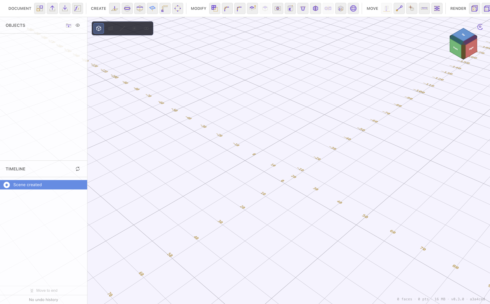

# PurpleCAD User Guide

PurpleCAD is a parametric 3D modelling app for makers: sketch in 2D, turn
sketches into solids, combine and refine them, and export a printable STL or a
STEP file for other CAD tools. Everything you build is recorded on a timeline
you can go back and edit at any time.

## Contents

Start here, then dip into whichever area you need — the pages are ordered from
first steps to advanced features and link to each other throughout.

1. **[Getting Started](getting-started.md)** — the interface at a glance,
   creating your first object, and saving your work.
2. **[Navigating & Viewing](navigation.md)** — orbiting, panning, zooming, the
   view cube, and the wireframe / shaded / transparent / path-traced render
   modes.
3. **[Creating Shapes](creating-shapes.md)** — primitives (box, sphere,
   cylinder, cone, torus) and reference planes.
4. **[Sketching in 2D](sketching.md)** — entering sketch mode and the draw
   tools (line, rectangle, circle, ellipse, arc, bezier, point, text).
5. **[Constraints & Dimensions](constraints-and-dimensions.md)** — locking a
   sketch's shape with geometric constraints and driving its size with
   dimensions and variables.
6. **[Sketch Tools](sketch-tools.md)** — chamfer, fillet, trim, offset, mirror,
   patterns, projection, and construction (dashed) geometry.
7. **[Extrude & Solid Editing](extrude-and-solids.md)** — turning a sketch into
   a solid, then chamfer/fillet, push/pull, shell, hole, emboss, draft, and
   texture on the resulting body.
8. **[Combine, Split & Sweep](combine-split-sweep.md)** — booleans (union / cut
   / intersection), splitting, revolve / pipe / loft, and 3D patterns.
9. **[Materials & Variables](materials-variables.md)** — giving bodies an
   appearance and driving dimensions with named variables and formulas.
10. **[Timeline & History](timeline-and-history.md)** — how the build history
    works, editing earlier steps, and undo / redo.
11. **[Importing & Exporting](import-export.md)** — `.pcad` documents, STL and
    STEP exchange, and PNG snapshots.

## The big picture

A typical part is built like this:

1. **Sketch** a 2D profile on a plane ([Sketching](sketching.md)), and pin its
   size with [constraints and dimensions](constraints-and-dimensions.md).
2. **[Extrude](extrude-and-solids.md)** that profile into a solid.
3. **Refine** the solid — round its edges, hollow it, cut holes
   ([Solid Editing](extrude-and-solids.md)).
4. **[Combine](combine-split-sweep.md)** it with other bodies if needed.
5. **[Export](import-export.md)** an STL to print or a STEP to share.

Every one of those steps lands on the **[timeline](timeline-and-history.md)**,
so you can reopen and change any of them later and everything downstream
rebuilds.

## Conventions in this guide

- **Click** means a left mouse click. **Ctrl/Cmd-click** and **Shift-click**
  are called out where they matter.
- Coordinates and sizes are in **millimetres** unless noted.
- PurpleCAD uses a **Z-up** frame — the same one the STL/STEP exports use — so
  "up" on screen is +Z. See [Navigating & Viewing](navigation.md).
- Screenshots show the default (light) theme; the app also has a dark theme.
