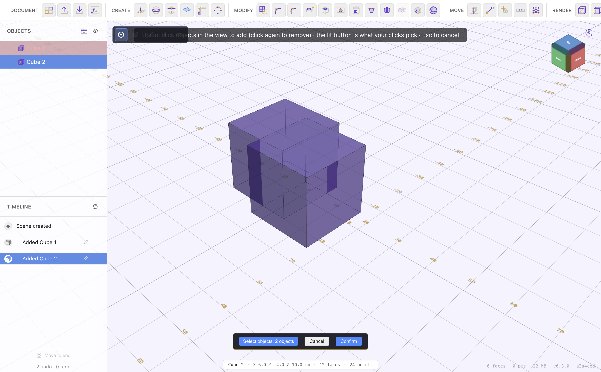

# Combine, Split & Sweep

[← Extrude & Solid Editing](extrude-and-solids.md) · [Contents](README.md) · Next: [Materials & Variables →](materials-variables.md)

These tools join bodies together, cut them apart, and build shapes by sweeping a
profile. They're in the **Modify** group when a body is selected.

## Boolean (Union / Cut / Intersection)

Combine two or more bodies into one.

1. Click **Boolean** and choose the operation:
   - **Union** — merge the bodies into one.
   - **Cut** — subtract the second body (and later ones) from the first.
   - **Intersection** — keep only the volume the bodies share.
2. **Click the bodies** in the viewport to add them (click again to remove). The
   lit button shows what your clicks pick.
3. **Confirm**. The inputs are consumed into one new body.

Union welds abutting solids cleanly (no hairline seams), so a later fillet or
chamfer on the joined body works. The boolean result is a body on the timeline;
editing an input rebuilds it.

## Split object

Slice one body into two with a face or plane.

1. Click **Split object**, pick the **object** to cut.
2. Pick a **face or plane** to slice along, then confirm.

You get two separate bodies, each carrying the original's name, so you can keep,
move, or delete each half independently.

## Split (a union back into its parts)

If a body is a **union**, the **Split** tool (Modify section) separates it back
into the original objects it was made from — the inverse of a Boolean Union.

## Sweep: Revolve / Pipe / Loft

The **Sweep** button builds a solid by moving a profile through space. Choose:

- **Revolve** — spin a sketch profile around an axis to make a turned part
  (a bottle, a knob, a wheel). Pick the profile and the axis, set the angle.
- **Pipe** — sweep a circular (or profile) cross-section along a path curve to
  make tubing, wires, or handles.
- **Loft** — blend between two or more profiles on different planes to make a
  smoothly-changing shape (a boat hull, a transition duct).

Each opens its own dialog to pick the profile(s), path/axis, and parameters, with
a preview before you confirm.

## 3D patterns: Repeat (Mirror / Circular / Rectangular)

The **Repeat** button patterns whole **bodies** in 3D (the 2D equivalents live in
[Sketch Tools](sketch-tools.md)):

- **Mirror** — reflect a body across a plane.
- **Circular** — repeat a body around an axis (bolt holes around a flange).
- **Rectangular** — repeat a body on a 3D grid.

Set the counts/spacing/axis in the dialog and confirm; the copies are linked to
the source and rebuild when it changes.

## Choosing an approach

- **Add** material → Union, or an add-**[extrude](extrude-and-solids.md)**.
- **Remove** material → Cut boolean, a cut-extrude, a **Hole**, or **Push/Pull**
  inward.
- **Keep only the overlap** → Intersection.
- **Turned or blended shapes** → Revolve / Loft.

---

Next: **[Materials & Variables →](materials-variables.md)**
