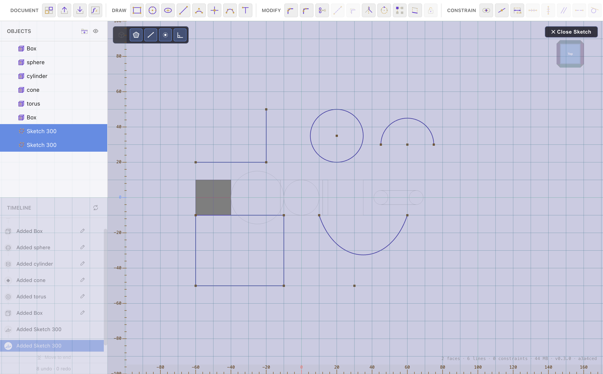

# Constraints & Dimensions

[← Sketching in 2D](sketching.md) · [Contents](README.md) · Next: [Sketch Tools →](sketch-tools.md)

Constraints lock a sketch's **shape**; dimensions lock its **size**. Together
they make a sketch *parametric* — change one number and the whole profile
updates while keeping every rule you set. The tools live in the **Constrain**
group while a sketch is open.

## Selecting what to constrain

Most constraints work on one or two picked elements:

- Click a **point** (an endpoint or a standalone point) or a **line** to pick
  it. The picked element highlights in the selection colour.
- For two-element constraints, pick the first, then the second.
- The **first-picked** element is the one the solver moves first, so pick the
  thing you want to stay put **second**.

While you're picking, the enclosed-region hover highlight is turned off so you
can aim at edges and points cleanly.

## Geometric constraints

| Constraint | What it does | Pick |
| --- | --- | --- |
| **Coincident** | Makes two points share a position | two points |
| **Midpoint** | Pins a point to the middle of a line, arc or curve | the point, then the target |
| **Horizontal** | Forces a line horizontal | one line |
| **Vertical** | Forces a line vertical | one line |
| **Parallel** | Makes two lines parallel | two lines |
| **Colinear** | Puts two lines on the same infinite line | two lines |
| **Tangent** | Line ↔ arc/circle, or two arcs/circles, tangent | two elements |
| **Equal** | Matches two lines' length, or two circles/arcs' radius | two elements |

Tip: draw a rectangle, add **Horizontal** to the top and bottom and **Vertical**
to the sides, and it stays a rectangle no matter how you drag it.

## Dimensions (distances)

The **Distance** tool sets an exact size. It's context-sensitive:

- **Line length** — click a line to dimension its length.
- **Between two points** — click one point, then another.
- **Point to a line** — click a point, then a line, for the perpendicular
  distance.
- **Between two parallel lines** — click one line, then a **second line that
  shares a horizontal / vertical / parallel constraint** with it, to dimension
  the perpendicular gap between them. (After the first line click, a hint reminds
  you that you can click a parallel line for the gap.)
- **Circle radius** — click a circle to dimension its radius.

Type the value (in mm) into the box that appears and press **Enter**. The sketch
solves to satisfy it.

**Double-click** a dimension label to change its value later. Deleting a
dimension (select it, press **Delete**) removes the size lock but leaves the
geometry.

## Formulas & variables in dimensions

A dimension value can be a **formula** referencing document variables — type
`Width` or `Width / 2 + 2` instead of a number. When the value is
formula-driven, its label shows a small **ƒ** prefix (e.g. `ƒ 80.0mm`). Change
the variable and every dimension using it updates. See
[Materials & Variables](materials-variables.md).

## Angle constraints

An **angle** dimension between two lines locks the angle between them; its label
reads in degrees. Combined with a couple of length dimensions this fully defines
a triangle or a wedge.

## Fully vs. under-constrained

You don't have to fully constrain a sketch to use it — an under-constrained
sketch still extrudes. But adding constraints and dimensions makes edits
predictable: a fully-defined sketch changes exactly the way you intend when you
tweak a number, with nothing drifting.

## Showing & hiding annotations

Two toggles (shown in the selection widget while a sketch is open, and via
`Shift+Z` / `Shift+X`) independently hide the **constraint icons** and the
**dimension labels + markers**, so you can declutter the view without removing
anything.

---

Next: **[Sketch Tools →](sketch-tools.md)**
