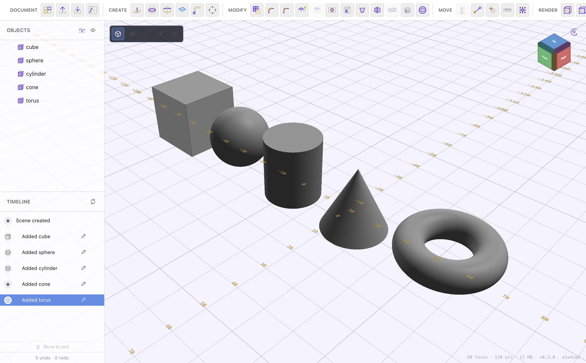

# Creating Shapes

[← Navigating & Viewing](navigation.md) · [Contents](README.md) · Next: [Sketching in 2D →](sketching.md)

There are two ways to bring geometry into a document: drop in a ready-made
**primitive**, or draw a **[sketch](sketching.md)** and turn it into a solid.
This page covers primitives and reference planes; sketching has its own
section.

## Primitives

Click the **primitive** button in the **Create** group and pick a shape:

| Primitive | Notes |
| --- | --- |
| **Box** | A rectangular block. Non-uniform Length X/Y/Z make any cuboid. |
| **Sphere** | Set the radius. |
| **Cylinder** | Set radius and height. |
| **Cone** | Set bottom radius, top radius (0 for a point), and height. A non-zero top radius makes a truncated cone / frustum. |
| **Torus** | A ring — set the ring radius and the tube radius. |

The shape appears at the origin, selected, with its transform gizmo. Set its
exact size in the properties panel (bottom-right):

- **Position (mm)** — where it sits.
- **Length (mm)** — its size per axis. The lock toggle keeps proportions.
- **Rotation (°)** — its orientation.

All of these accept **[formulas and variables](materials-variables.md)** — type
`Width` or `Width / 2` instead of a fixed number to drive the size from a
variable.

Primitives are exact analytic solids, so they stay perfectly round/flat at any
size and export cleanly.

## Reference planes

Solids are built on planes. The ground (world) plane is always available, but
you'll often want to sketch on a face of an existing body or on a custom plane.

Click the **Plane** button in the Create group:

- With a **sketch selected**, it creates a reference plane from that sketch.
- Otherwise, **pick 3 points** in the scene to define the plane.

A plane is a reference — it doesn't add material. Once you have one, select it
and start a sketch on it (see [Sketching in 2D](sketching.md)). You can also
start a sketch directly on a **flat face** of a body.

## Sketch planes vs. primitives

- Reach for a **primitive** when the shape is a basic solid — a block, a shaft,
  a ball.
- Reach for a **[sketch → extrude](extrude-and-solids.md)** when the profile is
  custom: a bracket outline, a gear tooth, a logo, anything with holes or curves
  you want to control precisely with [dimensions](constraints-and-dimensions.md).

The two mix freely — build a block, then boolean-cut a sketched profile out of
it. See [Combine, Split & Sweep](combine-split-sweep.md).

---

Next: **[Sketching in 2D →](sketching.md)**
