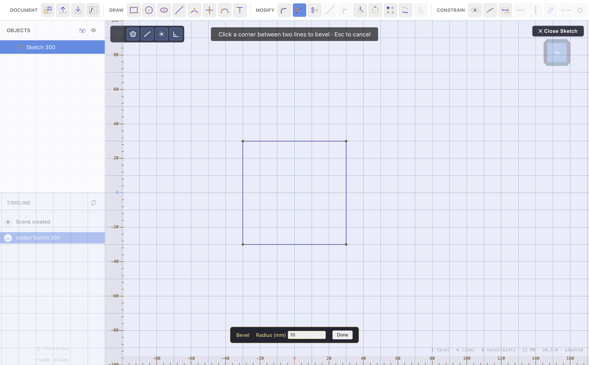

# Extrude & Solid Editing

[← Sketch Tools](sketch-tools.md) · [Contents](README.md) · Next: [Combine, Split & Sweep →](combine-split-sweep.md)

This is where a 2D sketch becomes a 3D part, and where you refine that part —
rounding edges, hollowing it out, cutting holes, and more. The solid-editing
tools live in the **Modify** group when a body is selected.

## Extrude a sketch into a solid

Extruding pushes a closed sketch profile along its normal to make a solid.

1. Open the sketch and start the **extrude** flow, or select the sketch and
   extrude it.
2. **Click the closed regions** you want (click again to deselect) — a sketch
   can have several separate loops, and holes are handled automatically.
3. Set the **depth** in the overlay and **Confirm**.

Notes:

- The extrude starts **at the sketch plane** (not centred on it). A **negative**
  depth extrudes backwards.
- Turn on **Cut** in the overlay to subtract the extruded solid from the target
  instead of adding it — the profile becomes a pocket.
- **Start-from** lets you begin the extrude from a picked face rather than the
  sketch plane.
- **To…** sets the depth for you: click it, then click a face, and the depth
  becomes the distance to that face, so the extrude ends on it. On a face
  parallel to the sketch it lands exactly on the face; on a sloped face it
  reaches the point you clicked. It fills in a number, so it doesn't follow
  the face if that moves later.

The result is a solid body on the [timeline](timeline-and-history.md); its
recipe remembers the sketch, so editing the sketch rebuilds the solid.

## Chamfer & Fillet (edges)

Round or bevel the **edges** of a solid.

- **Chamfer** — a flat angled cut along the edge; set a **distance**.
- **Fillet** — a rounded edge; set a **radius**.

To use: pick **Chamfer** or **Bevel**, then **Ctrl-click edges** (or Alt-click
faces to select all their edges) in the viewport. A live ghost preview shows the
result. Set the distance/radius (formulas allowed) and **Confirm**.

> The 3D fillet uses the geometry kernel's fillet engine, which takes a
> **positive** radius only. (The concave/negative flip is a
> [sketch fillet](sketch-tools.md) feature.)

## Push / Pull

Move faces along their normal to add or remove material.

1. Pick **Push/Pull**, then **select faces**.
2. Set a **distance** and confirm — the faces move out (add) or in (remove).

A quick way to thicken a wall, deepen a pocket, or extend a boss.

## Shell

Hollow a body to a wall thickness — turning a solid block into an open box.

1. Pick **Shell**, select the body (and optionally the face(s) to leave open).
2. Set the **wall thickness** and confirm.

## Hole

Cut a clean (optionally threaded) hole.

1. Pick **Hole**, click a **face**, then a **point** on it for the centre.
2. Set the **diameter**, **depth**, and whether it's **threaded**, then confirm.

Because the hole's recipe stores the face and point, it rebuilds correctly if
the body changes.

## Emboss

Stamp sketch geometry onto a face as a raised or recessed relief — text, a logo,
a serial number.

1. Draw the profile in a sketch.
2. Pick **Emboss**, pick the target **face** and the sketch, set the **depth**
   and whether it's raised or recessed.
3. Choose **project** (flat) or **conform** (wrap around a curved wall, using the
   same wrap icon as the texture tool), then confirm.

## Draft

Taper faces about a neutral face — essential for moulding and casting so parts
release from the mould.

1. Pick **Draft**, select the **neutral (main) face**, then the **face(s)** to
   taper.
2. Set the **draft angle** and confirm.

## Texture (displacement)

Displace a face with a black-and-white image to create genuine 3D surface
detail — scales, knurling, fabric, industrial textures.

1. Pick **Texture**, select the connected **faces**.
2. Choose a PNG from the built-in library (animal scales, fabrics, industrial
   surfaces) or import your own; name and manage library images as you go.
3. Set the **size**, **depth**, horizontal/vertical **offset**, **rotation**,
   **wrap**, and **resolution**. A live preview shows the displaced surface.
4. Confirm. The operation can be **cancelled** mid-build, and the preview result
   is reused on confirm.

Higher resolution means finer detail but a heavier mesh; the preview clamps
resolution so typing stays responsive, and the commit runs the full detail.

## Editing any of these later

Each tool writes a **timeline** step with an **Edit** button that re-opens the
same UI seeded from your original settings, viewing the pre-operation state. Many
also have **Retarget** to re-pick a source. Change a value and the entry updates
in place — no duplicate step. See [Timeline & History](timeline-and-history.md).

---

Next: **[Combine, Split & Sweep →](combine-split-sweep.md)**
