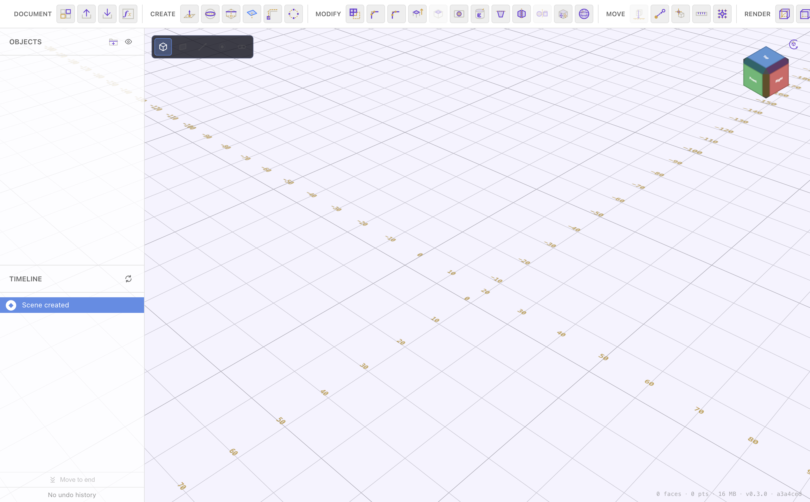
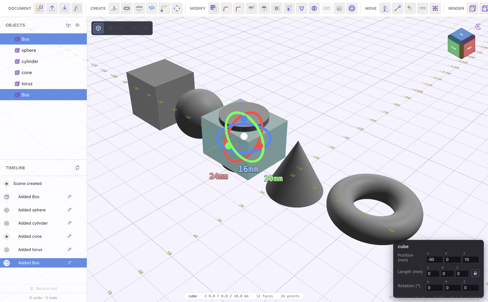
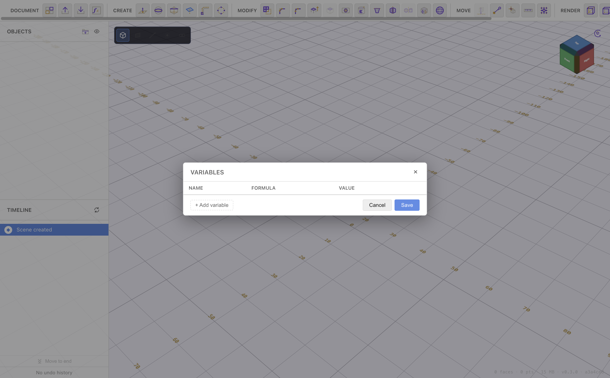

# Getting Started

[← Back to contents](README.md) · Next: [Navigating & Viewing →](navigation.md)

This page introduces the interface and walks you through creating, editing, and
saving your first object.

## The interface

- **Toolbar** (top) — grouped by task: **Document**, **Create** (or **Draw**
  in a sketch), **Modify**, **Move / Constrain**, **Render**, and **Options**.
  Which groups appear depends on what you have selected — selecting a sketch
  swaps the Create tools for 2D drawing tools.
- **Objects** panel (top-left) — the list of every body and sketch in the
  document. Click a name to select it; the eye and folder icons manage
  visibility and grouping.
- **Timeline** panel (bottom-left) — the ordered history of everything you've
  made. Each step can be re-opened and edited. See
  [Timeline & History](timeline-and-history.md).
- **Viewport** (centre) — the 3D scene, with a ground grid, a world-axis
  indicator, and a **view cube** in the top-right corner.
- **Status line** (bottom-right) — face/point counts, memory use, and the
  version. In a sketch it shows the sketch's own counts, or the current
  selection's counts.

## Creating your first object

1. In the **Create** group, click the **primitive** button and choose a shape —
   Box, Sphere, Cylinder, Cone, or Torus. See [Creating Shapes](creating-shapes.md).
2. The shape appears at the origin and is added to the Objects list and the
   Timeline.
3. Click the object (in the viewport or the list) to **select** it. A transform
   gizmo appears and a properties panel opens in the bottom-right.

## Moving, rotating & scaling

With an object selected:

- Drag the **gizmo** rings/arrows to rotate or move it in the viewport.
- Or type exact **Position**, **Length**, and **Rotation** values into the
  properties panel. The lock toggle next to Length keeps the proportions when
  you change one dimension.
- The **Move** group adds helpers: **Drop to ground** (sits the selection on
  Z = 0), **Point to Point** (align a vertex of one object to a vertex of
  another), and **Change origin** (pick the pivot used for rotation/scale).

Values that matter can be **formulas** referencing named variables — see
[Materials & Variables](materials-variables.md).

## Selecting things

- **Click** an object to select it; click empty space to deselect.
- **Shift-click** adds to / removes from the selection.
- Some tools want **faces** or **edges** instead of whole objects — those tools
  tell you what to pick in a hint at the top of the viewport (for example,
  Ctrl-click an edge for a [fillet](extrude-and-solids.md)).

## Undo, redo & the timeline

- **Ctrl/Cmd-Z** undoes, **Ctrl/Cmd-Shift-Z** redoes.
- Every action is also a step on the **[Timeline](timeline-and-history.md)** —
  you can scrub back to an earlier step or re-open a step to edit it, and the
  rest of the model rebuilds.

## Saving & loading

Open the **Save / Export** menu in the Document group:

- **Save as `.pcad`** — the native, fully-editable document format. Re-open it
  later with everything (sketches, timeline, variables) intact.
- **Export STL** — a 3D-printable mesh of the visible bodies.
- **Export STEP** — a solid model for other CAD packages.
- **Save PNG** — a snapshot of the viewport.

The matching **Load / Import** menu opens a `.pcad` document or brings in an STL
/ STEP file as a body. Full detail in [Importing & Exporting](import-export.md).

---

Next: **[Navigating & Viewing →](navigation.md)**
