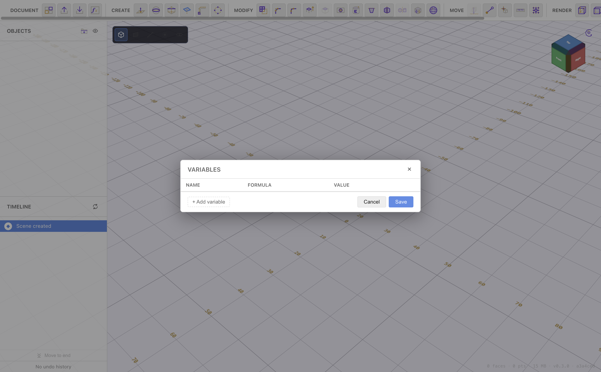

# Importing & Exporting

[← Timeline & History](timeline-and-history.md) · [Contents](README.md)

PurpleCAD reads and writes several formats: its own editable `.pcad` documents,
plus STL and STEP for exchange with slicers and other CAD tools.

## The Document menus

Both live in the **Document** group at the far left of the toolbar:

- **Save / Export** — write the document or export geometry.
- **Load / Import** — open a document or import a mesh/solid.

## Saving & opening documents (`.pcad`)

- **Save as `.pcad`** — the native format. It stores everything: sketches,
  constraints, the full [timeline](timeline-and-history.md), variables, and
  materials. Re-open it and every step is still editable.
- **Open a saved `.pcad`** — from the Load / Import menu.

Use `.pcad` as your working format and only export STL/STEP when you need to
print or share.

## Exporting geometry

| Export | Use it for |
| --- | --- |
| **STL** | 3D printing — a triangle mesh of the visible bodies |
| **STEP** | Handing a solid model to other CAD software |
| **PNG** | A snapshot image of the viewport |

Notes:

- Exports include the **visible** bodies only — hide helper geometry first (see
  [Navigating & Viewing](navigation.md)).
- STL/STEP export at the current **print precision**, straight from the mesh
  you see on screen, so what you export matches what's displayed.
- Exports rotate into the **Z-up** convention every CAD reader and slicer
  expects, so parts land the right way up.

## Importing geometry

| Import | Result |
| --- | --- |
| **STL mesh** | Brought in as a solid body |
| **STEP file** | Brought in as a solid body |

Imported bodies join the Objects list and the timeline like any other body, so
you can boolean, fillet, or pattern against them. (A round-trip STEP export →
import reproduces the solid.)

An STL that isn't a closed solid — one with holes in its surface — is still
imported, with a warning saying how many open edges it has. A boolean with such
a body goes ahead but warns too: where the surface is open, the result can have
holes.

### Simplifying a mesh

A detailed STL can carry far more triangles than its shape needs, and every one
of them slows booleans on it. **Simplify** (in Modify, with a mesh body
selected) removes triangles in one of two ways:

- **Deviation** — as many as possible while no point of the new surface lies
  further than the distance you set (default 0.05 mm) from the original, or the
  other way round. The distance is measured over the whole surface, not
  estimated, so it holds.
- **Triangle count** — down to the number you give. The dialog then tells you
  how far that moved the surface.

The preview shows the result's triangles over the body and the count before and
after. Simplify keeps the body closed if it was, and never joins two separate
parts of its surface. It adds a step to the timeline; **Edit** on that step
reopens the dialog.

## Projects

The **Projects** button (Document group) manages multiple documents and switches
between them, and can **duplicate** a project — handy for trying a variation
without touching the original.

---

That's the full tour. Jump back to the **[Contents](README.md)**, or revisit
the workflow overview there to see how sketching, extruding, refining, combining,
and exporting fit together.
