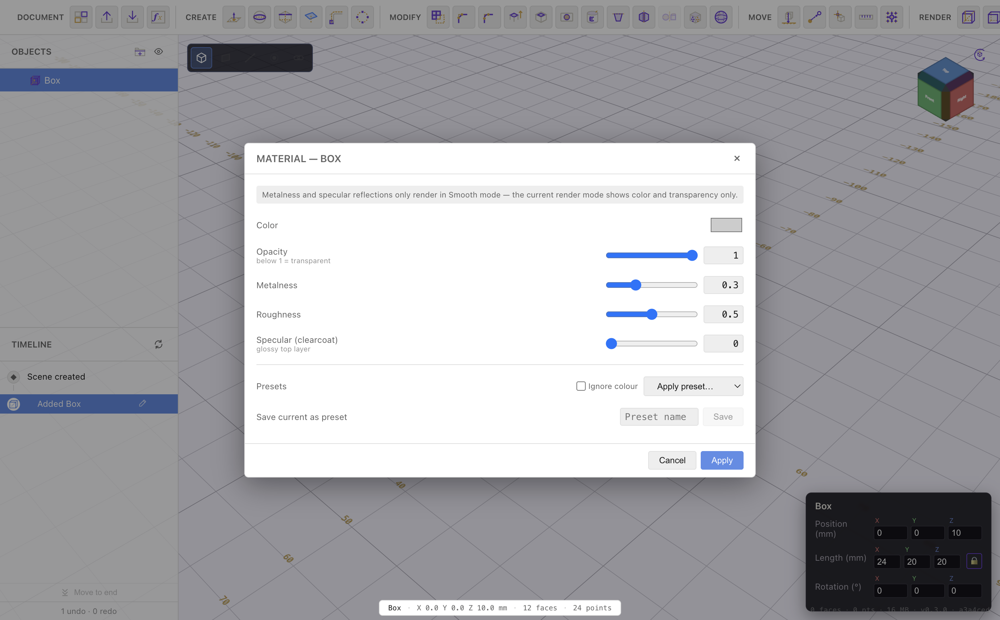
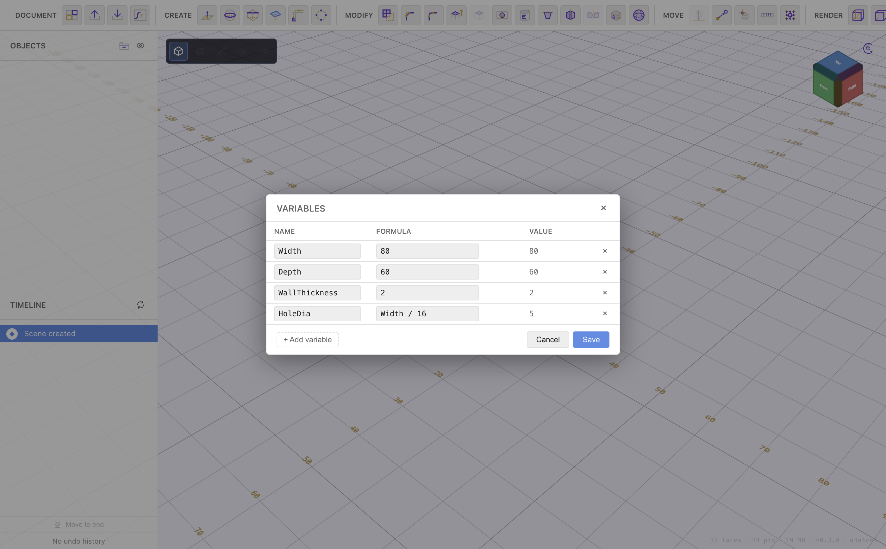

# Materials & Variables

[← Combine, Split & Sweep](combine-split-sweep.md) · [Contents](README.md) · Next: [Timeline & History →](timeline-and-history.md)

Two document-wide features: **materials** give bodies an appearance, and
**variables** drive dimensions from a handful of named numbers.

## Materials

Give a body a colour and surface finish (this affects appearance and the
path-traced render, not the exported geometry).

1. Select a body.
2. Click **Material** in the Modify group to open the dialog.
3. Set the **colour** and appearance sliders — **metalness**, **roughness**,
   **opacity**, and **clearcoat** — then **Apply**.

Metalness + roughness together cover most looks: low metalness + high roughness
reads as matte plastic; high metalness + low roughness reads as polished metal.
Opacity below 1 makes translucent bodies (glass, tinted covers), which look best
in the [path-traced render mode](navigation.md).

## Variables

A **variable** is a named number (or formula) that dimensions and sizes can
reference. Change the variable and everything using it updates — the essence of
parametric design.

Open the **Variables** dialog (the `ƒx` button in the Document group):

- **Name** — how you refer to it (e.g. `Width`, `WallThickness`, `HoleDia`).
- **Formula** — a number or an expression, which may reference **other
  variables** (`Width / 16`, `Depth - WallThickness * 2`).
- **Value** — the evaluated result, shown live.

Add rows with **+ Add variable**, remove with the **×**, then **Save**.

## Using variables everywhere

Anywhere you type a size, you can type a variable or a formula instead of a
number:

- **[Sketch dimensions](constraints-and-dimensions.md)** — `Width`, `Width / 2 + 2`.
- **[Fillet / chamfer](sketch-tools.md)** setback and radius.
- **[Rectangular pattern](sketch-tools.md)** counts and offsets.
- **Primitive** sizes and **transform** fields.
- **[Extrude](extrude-and-solids.md)** depths and other 3D-tool values.

Fields with formula support show autocomplete for variable names as you type,
and dimension labels driven by a formula show a small **ƒ** prefix (for example
`ƒ 80.0mm`) so you can tell parametric dimensions from fixed ones at a glance.

### Worked example

Define `Width = 200`, `Depth = 130`, `WallThickness = 2`, `HoleDia = 12`. Sketch
a rectangle dimensioned `Width` × `Depth`, place bolt holes dimensioned
`HoleDia`, and space a hole pattern by `Width - HoleDia - WallThickness * 2`.
Now change `Width` to `250` in the Variables dialog and the outline, the holes,
and the pattern spacing all update together — the whole part resizes from one
number.

## Precision

Values you type, see, and store are handled with exact decimal arithmetic, so
`0.1 + 0.2` is exactly `0.3` — no floating-point drift in your dimensions.

---

Next: **[Timeline & History →](timeline-and-history.md)**
