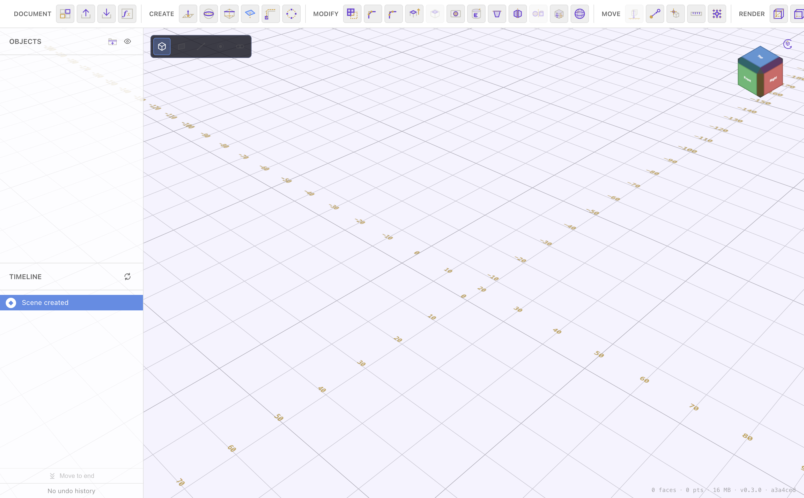
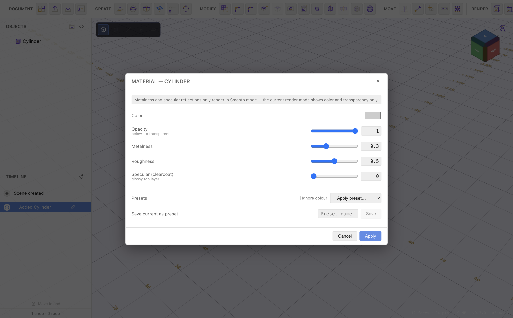

# Navigating & Viewing

[← Getting Started](getting-started.md) · [Contents](README.md) · Next: [Creating Shapes →](creating-shapes.md)

PurpleCAD is designed for a trackpad (or a mouse wheel). Navigation is done with
scroll gestures plus a modifier key, and with the on-screen **view cube**.

## Orbit, pan & zoom

| Gesture | Action |
| --- | --- |
| Two-finger scroll (or wheel) | **Pan** the view |
| **Shift** + scroll | **Orbit** (rotate) around the target |
| **Ctrl** + scroll, or a two-finger **pinch** | **Zoom** in / out |
| **Cmd** + scroll | Pan (alternate) |

A small ring briefly appears at the point you orbit around so you can see the
pivot. Zoom always moves toward the centre of the view.

In a **sketch**, plain scroll pans the 2D view and Ctrl + scroll zooms, so
navigating a sketch feels the same as navigating the 3D scene.

## The view cube

The cube in the top-right corner shows the current orientation and is also a
control:

- Click a **face** (Top, Front, Right, …) to snap the camera to that standard
  view.
- Click the small **home** button on the widget to **reset the view** — it
  frames all the visible bodies so everything is on screen.

The **world-axis indicator** and the **ruler** ticks around the viewport always
read in true world millimetres, so you can gauge sizes at a glance.

## Coordinate frame (Z-up)

PurpleCAD shows a **Z-up, right-handed** frame — the same one STL and STEP
exports use. So:

- **Z** is up.
- **X** is right, **Y** is into the screen (away from you) at the home view.

Every axis-labelled field in the app (the transform panel, plane dialog, pattern
spacing, the axis indicator) uses this frame, so what you type matches what you
see and what gets exported.

## Render modes

The **Render** group switches how bodies are drawn. It doesn't change the model —
only its appearance on screen.

| Mode | Key | What it shows |
| --- | --- | --- |
| **Wireframe** | `1` | Edges only — see through everything |
| **Transparent** | `2` | 50% see-through solids |
| **Shaded** | `3` | Normal solid shading (the default) |
| **Path-traced** | `4` | A progressive, photo-realistic GPU render (prototype) |

Path-traced mode refines over a second or two into a soft-shadowed, realistic
image — good for a final look once the model is done. It's heavier than the
other modes, so use it when you want a presentation image rather than while
modelling.

## Visibility

In the **Objects** panel each item has an eye toggle to hide/show it, and items
can be grouped into folders. Hidden bodies are excluded from exports, so you can
hide helper geometry before exporting an STL.

---

Next: **[Creating Shapes →](creating-shapes.md)**
