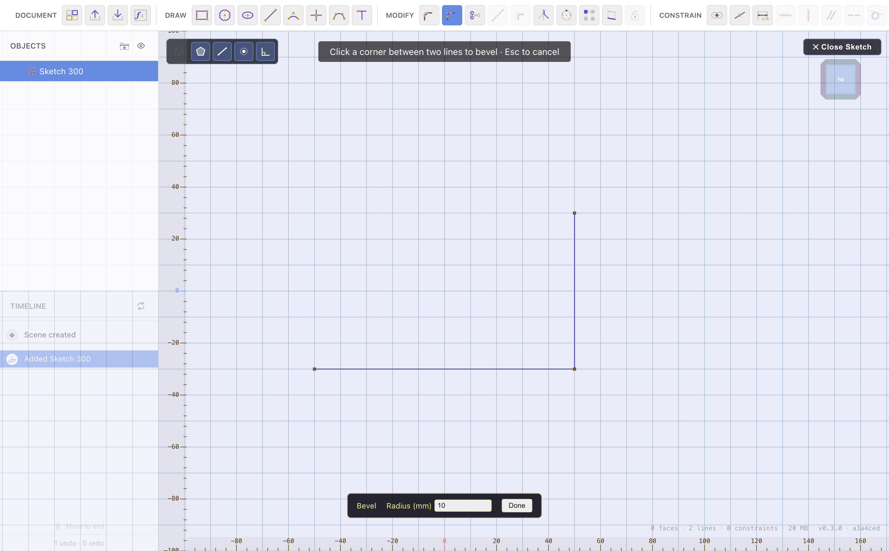

# Sketch Tools

[← Constraints & Dimensions](constraints-and-dimensions.md) · [Contents](README.md) · Next: [Extrude & Solid Editing →](extrude-and-solids.md)

Beyond drawing and constraining, the **Modify** group (while a sketch is open)
reshapes and repeats sketch geometry. Every result is parametric — it updates
when the geometry it depends on changes.

## Chamfer & Fillet (corners)

Round or bevel a corner where two lines meet.

- **Chamfer** — replaces the corner with a straight cut.
- **Bevel (fillet)** — replaces the corner with a smooth arc.

To use: pick **Chamfer** or **Bevel**, set the **Setback** (chamfer) or
**Radius** (fillet) in the bottom dialog, then **click the corner** between two
lines. The value accepts a **[formula/variable](materials-variables.md)** and
shows a **ƒ** prefix on its label when it's formula-driven.

Corners are **derived** geometry — they're applied *after* the sketch's
dimensions resolve and re-applied wherever the geometry ends up, so they never
fight your dimensions and never make the sketch hard to move. You can't select
or drag the arc itself; edit its size by clicking its value label (double-click
re-opens the input).

**Negative fillet radius:** enter a negative number for a fillet to **flip the
arc** — a concave scoop into the corner instead of a convex round.

## Trim

Remove part of a line up to where it crosses another line. Pick **Trim**, then
**click or drag over** the segment to remove — it's cut back to the nearest
crossing with another line or point. Great for cleaning up overlapping
construction lines into a clean profile.

## Offset

Make a parallel copy of the selected lines at a fixed distance, linked by a
distance constraint so it tracks the original.

- Select the line(s), click **Offset**, and set the distance.
- Hold **Shift** to offset to the other side.

The offset copy is driven by its constraint — edit the original and the offset
follows. Double-click the offset's distance label to change it.

## Mirror

Reflect geometry across a line.

1. Click **Mirror**, then click a **line** to use as the mirror axis.
2. Click the geometry to reflect (click again to remove), then **Confirm**.

The mirrored copies are linked to their sources — move a source and its
reflection follows. The Mirror tool can even reference **already-mirrored**
geometry, so you can mirror a copy across a second line to build up symmetric
arrangements.

## Patterns

Repeat geometry in a grid or around a centre.

- **Circular Pattern** — pick a **centre point**, then click the geometry to
  repeat it around that centre. Set the number of instances (per 360°).
- **Rectangular Pattern** — repeat the selected geometry on an **X/Y grid**. Set
  Count X/Y and the mm offsets — all four accept
  **[formulas/variables](materials-variables.md)**.

Pattern copies are derived and linked to the source. To **delete** a whole
pattern (or a mirror), select any one of its copy markers and press **Delete** —
the entire operation is removed, leaving the source. Double-click a pattern
marker to re-open the tool and edit its counts/spacing.

## Project

Bring a 3D body's edge into the current sketch as reference geometry.

- Click **Project**, then click a **3D edge** — its connected edges are
  projected onto the sketch plane. Or drag a box to project everything inside.
- Projected geometry **tracks its source** and is immovable until released.
- **Release projection** strips the tracking constraint, leaving ordinary
  editable lines.

Use it to align a new sketch to features already on a body.

## Construction (dashed) lines

**Toggle Dashed** turns selected lines into construction geometry: they help you
constrain and align (centrelines, bounding references) but don't form closed
regions and aren't extruded. Toggle again to make them solid.

---

Next: **[Extrude & Solid Editing →](extrude-and-solids.md)**
