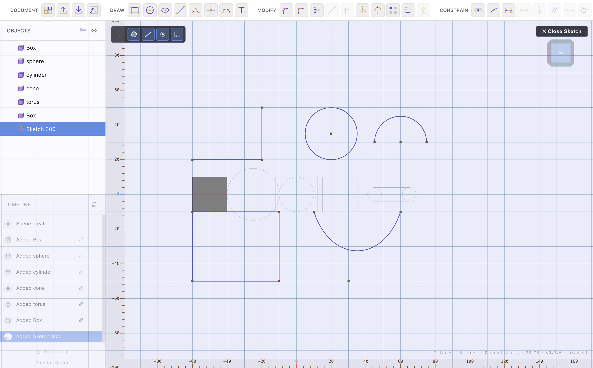
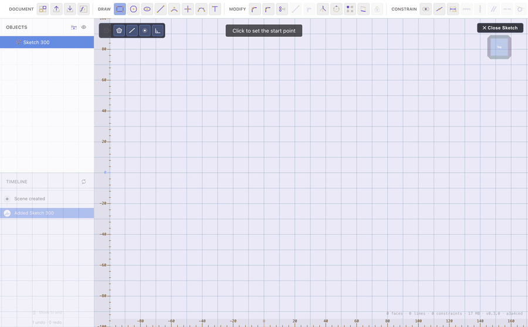

# Sketching in 2D

[← Creating Shapes](creating-shapes.md) · [Contents](README.md) · Next: [Constraints & Dimensions →](constraints-and-dimensions.md)

A sketch is a 2D drawing on a plane that you later turn into a solid by
[extruding](extrude-and-solids.md) it (or revolving, sweeping, embossing…). This
page covers entering sketch mode and the drawing tools. Locking a sketch's shape
and size is covered in [Constraints & Dimensions](constraints-and-dimensions.md);
editing tools like fillet and mirror are in [Sketch Tools](sketch-tools.md).

## Entering and leaving a sketch

- Start a new sketch on the **ground plane**, a **[reference plane](creating-shapes.md)**,
  or a **flat face** of a body.
- The camera flies to look straight down at the sketch plane, rulers appear, and
  the toolbar's Create group is replaced by the **Draw** tools.
- Click **Close Sketch** (top-right) when you're done. The sketch stays in the
  document and can be re-opened and edited any time.

## The draw tools

Pick a tool from the **Draw** group, then click in the viewport. The status hint
at the top tells you what each click does.

| Tool | How to use it |
| --- | --- |
| **Line** | Click a start point, then each subsequent point — lines chain end-to-end. Press **Esc** to end the chain. |
| **Rectangle** | Click one corner, then the opposite corner. |
| **Circle** | Click the centre, then a point on the rim to set the radius. |
| **Ellipse** | Click the centre, then set the two radii. |
| **Arc** | Draw a circular arc through its defining points. |
| **Bezier** | Click the start, then the end; the curve gets default handles. Select it afterwards to drag the handles and reshape it. |
| **Point** | Click to drop a point. On a line it's constrained to the line (handy as a reference or a hole centre). |
| **Text** | Click a start point, then type in the dialog. The text becomes editable outline geometry. |

Drawing the rectangle tool:

## Snapping

While you draw, the cursor **snaps** to helpful spots so shapes connect cleanly:

- Existing **endpoints, centres, and midpoints** (a marker highlights the snap).
- The **grid**, when no geometry is nearby.

Snapping is what makes a chain of lines actually meet at shared points — which
in turn lets constraints and closed-region detection work. A closed loop of
connected lines is what you extrude into a solid.

## Straight-angle lock (Shift)

Hold **Shift** while drawing a **line** to lock its direction to the nearest
**45°** increment (0°, 45°, 90°, …). If the locked line comes out horizontal or
vertical, it automatically gets the matching
[horizontal/vertical constraint](constraints-and-dimensions.md) so it stays that
way — no need to add it by hand.

## Construction (dashed) geometry

Toggle a line to **dashed** with the **Toggle Dashed** button (in the Modify
group). Dashed lines are *construction* geometry: they help you constrain and
align things (a centreline, a bounding box) but they **don't** form closed
regions and aren't extruded. See [Sketch Tools](sketch-tools.md).

## What makes a good sketch

1. Draw the rough shape with the tools above, letting snapping connect the ends.
2. Lock its *shape* with geometric
   **[constraints](constraints-and-dimensions.md)** (horizontal, parallel,
   equal…).
3. Lock its *size* with **[dimensions](constraints-and-dimensions.md)**, ideally
   driven by **[variables](materials-variables.md)** so the whole part resizes
   from a few numbers.
4. [Extrude](extrude-and-solids.md) the closed profile into a solid.

---

Next: **[Constraints & Dimensions →](constraints-and-dimensions.md)**
